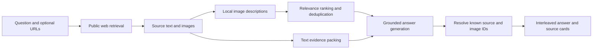

# CiteWeave

**Multimodal web search. Useful images. Traceable answers.**

[](https://github.com/wavachao/citeweave/actions/workflows/ci.yml)
[](https://www.python.org/)
[](LICENSE)

[简体中文](README.zh-CN.md) · [DeepSeek Harness](https://github.com/wavachao/citeweave/tree/feature/deepseek-harness-images) · [Deployment](docs/DEPLOYMENT.md) · [Configuration](docs/CONFIGURATION.md) · [API](docs/API.md) · [Evaluation](docs/RESULTS.md)

CiteWeave is a self-hosted search application that turns public webpages into answers with relevant illustrations and inspectable sources. It retrieves actual images, describes their visible content, selects useful figures, and places them alongside the explanation. Every displayed image retains a path back to its original webpage.


## What it does

- **Search and read the web** — automatic discovery or up to five explicit public source URLs; no benchmark dataset is needed to use the application.
- **Explain with images** — local visual descriptions, query–caption ranking, redundancy control, and illustrations placed next to related paragraphs.
- **Keep evidence inspectable** — paragraph citations, source cards, image previews, original-page links, and an image viewer.
- **Support everyday use** — browser-local search history, reusable answers, copy, Markdown export, and explicit refresh.
- **Run in your own environment** — local Qwen models on one NVIDIA GPU, or optional DeepSeek text generation.
- **Operate as a protected workspace** — bearer-token/API access, HttpOnly browser sessions, request limits, bounded SQLite answer caching, health checks, and a non-root container definition.

## DeepSeek Harness

CiteWeave's native DeepSeek Harness plugin adds sourced images to final agent answers. The independently deployed CiteWeave backend retrieves text evidence and selects relevant images; Harness writes the answer and displays illustrations with source links.

[Browse the integration branch](https://github.com/wavachao/citeweave/tree/feature/deepseek-harness-images) · [Installation and configuration](https://github.com/wavachao/citeweave/blob/feature/deepseek-harness-images/plugins/deepseek-harness/README.md)

## Quick start

### Requirements

- Linux, Python 3.12, and [uv](https://docs.astral.sh/uv/).
- A CUDA-capable NVIDIA GPU; the tested configuration uses a **24 GB RTX 4090 D**.
- A driver compatible with the locked PyTorch CUDA 12.8 wheels, about **50 GB free disk**, and outbound access to model downloads and public webpages.

```bash
git clone https://github.com/wavachao/citeweave.git
cd citeweave
uv sync --frozen
cp .env.example .env
uv run python scripts/download_models.py
uv run python -m citeweave serve
```

Open **http://127.0.0.1:8765**. Ask a question or supply specific source URLs. The first request loads models and may take longer than subsequent searches.

The default model download installs the three application models only. Training data, benchmark images, and the reference implementation are optional research resources. Model revisions are pinned; inference loads local files.

### Add the trained image ranker

The application works with a cosine-similarity fallback. To use the released task-tuned query–caption cross-encoder:

```bash
uv run python scripts/download_ranker.py
```

The downloader verifies the release archive and weight hashes before installing into `runs/crossencoder/`. The ranker is derived from MS MARCO MiniLM and uses Apache-2.0; application code uses MIT. See [model provenance](docs/MODELS.md).

### Deploy a workspace

Set a random `CITEWEAVE_ACCESS_TOKEN` with at least 32 characters in `.env`. For example, generate a value locally with `uv run python -c "import secrets; print(secrets.token_urlsafe(32))"`.

```bash
docker compose up --build -d
```

The supplied Compose configuration requires NVIDIA Container Toolkit, persists cached answers/images, mounts model resources read-only, and binds the host port to loopback. A reverse proxy can provide HTTPS for a team workspace. Network binding requires an access token. **Use one application worker per GPU.** Follow the [deployment guide](docs/DEPLOYMENT.md) for setup, readiness checks, backups, and operating limits.

## How it works



The application resolves source and image markers against retrieved evidence, keeping each illustration linked to its original page. Visual descriptions and publisher captions are stored separately.

The backend uses FastAPI, PyTorch, Transformers, sentence-transformers and SQLite. The browser interface uses plain HTML, CSS and JavaScript, with no frontend build step. See [architecture](docs/ARCHITECTURE.md).

## API

```bash
curl http://127.0.0.1:8765/api/search \
  -H "Content-Type: application/json" \
  -H "Authorization: Bearer $CITEWEAVE_ACCESS_TOKEN" \
  -d '{"query":"How did Eratosthenes measure Earth?","urls":["https://en.wikipedia.org/wiki/Eratosthenes"],"verify_images":true}'
```

Responses contain answer blocks, resolved image/source IDs, source metadata and timing. `refresh: true` bypasses the recent-answer cache. See the [API reference](docs/API.md) or `/docs` on your own deployment.

## Evaluation and reproducibility

CiteWeave includes ranker training, a pinned M²RAG reference implementation, and reproducible generation and evaluation tools.

The trained image ranker achieves **0.75981 graded NDCG@5**, compared with **0.72445** for cosine similarity, on 186 held-out questions with released VLM relevance labels.

The generation comparison uses Qwen2.5-7B-Instruct on one RTX 4090 D with shared input and output token limits:

| Measurement | M²RAG multi-stage | CiteWeave |
|---|---:|---:|
| Median generation time · 194 questions | 30.71 s | 8.04 s |
| Mean output images · 194 questions | 3.216 | 0.871 |
| Overall score · 20 paired questions, DeepSeek judge | 0.72718 | 0.71914 |

Full metrics, confidence intervals, image-selection behavior and reproduction settings are in [measured results](docs/RESULTS.md) and the [experiment protocol](docs/PROTOCOL.md).

## Development

```bash
uv sync --frozen --group official
uv run ruff check src scripts tests
uv run ruff format --check src scripts tests
uv run pytest -q
```

CI runs the CPU-only contract suite without downloading model weights. A GPU deployment must also pass a real retrieval/generation check. Contributing instructions, test scope, and checks for changes are in [CONTRIBUTING.md](CONTRIBUTING.md).

## Deployment notes

- The service uses **one workspace and one application worker per GPU**. It serializes expensive work and returns a retryable busy response.
- Web access depends on upstream availability. For a managed deployment, configure a controlled SearXNG endpoint rather than relying on the default DDGS discovery service.
- Retrieval supports public webpages. Dynamic pages, paywalls and unavailable images can limit the evidence returned.
- Browser history stays on the device; server answers and images are cached on the deployment volume. Configure retention and avoid entering secrets in queries.

## License and acknowledgments

Application code: [MIT](LICENSE). Models, fonts, datasets, and retrieved material retain their own licenses; see [THIRD_PARTY.md](THIRD_PARTY.md). Documentation screenshots containing the attributed Wikimedia diagram use CC BY-SA 4.0.

Built with [Qwen](https://github.com/QwenLM), [BGE](https://github.com/FlagOpen/FlagEmbedding), and the [M²RAG reference implementation](https://github.com/maziao/M2RAG).
