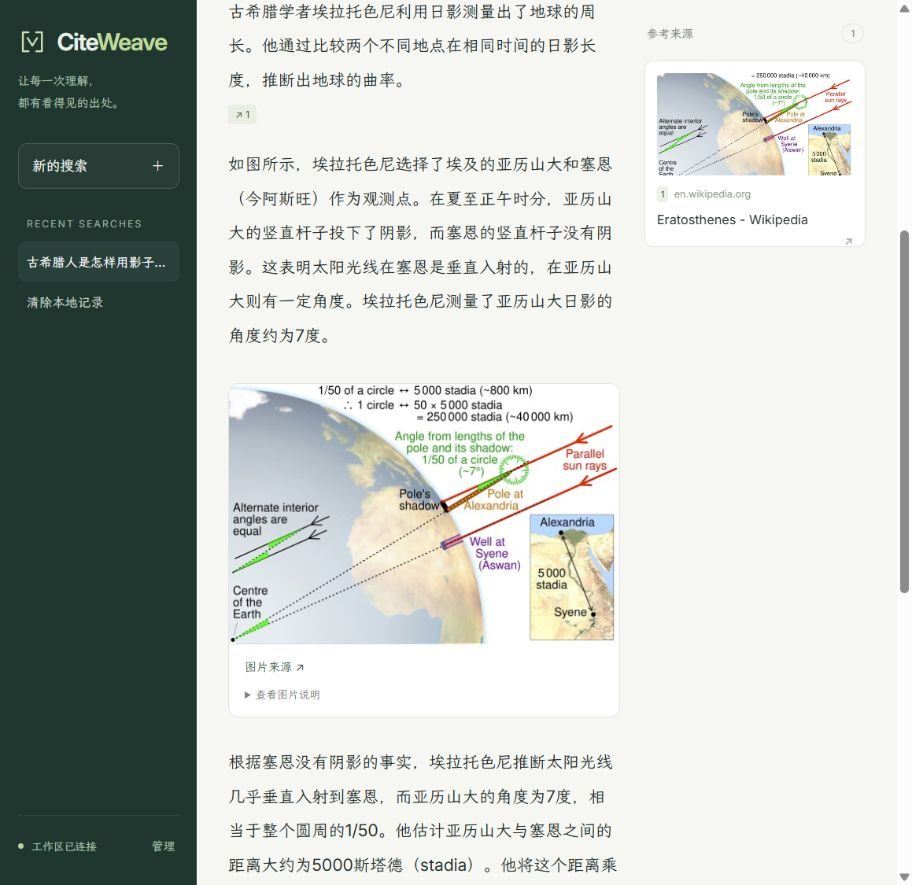

# CiteWeave

**可溯源的图文 AI 搜索，让解释与图片出现在同一个答案里。**

[English](README.md) · [DeepSeek Harness](https://github.com/wavachao/citeweave/tree/feature/deepseek-harness-images) · [部署指南](docs/DEPLOYMENT.md) · [配置](docs/CONFIGURATION.md) · [API](docs/API.md) · [实测结果](docs/RESULTS.md)

CiteWeave 是可自行部署的多模态搜索应用。它检索真实网页和图片，用本地视觉模型理解图片内容，通过相关性排序选出有用插图，再生成带段落引用的解释。用户可以放大图片、查看来源缩略图、跳转原文，并保存或导出回答。



## 核心能力

- 自动联网搜索，或指定最多 5 个公开网页；使用产品无需下载基准数据集。
- 本地图片理解、问题与图片说明联合排序、冗余控制和图文交错回答。
- 段落引用、图片原始来源、来源卡片和图片放大。
- 浏览器本地搜索历史、近期回答缓存、复制、Markdown 导出和重新检索。
- 访问令牌、HttpOnly 会话、请求限流、健康检查、SQLite 持久化与非 root 容器部署。
- 自托管字体：英文 Inter，中文霞鹜文楷；界面运行时不依赖字体 CDN。

## DeepSeek Harness

CiteWeave 原生插件让 DeepSeek Harness 的最终回答包含有来源的图片。独立部署的 CiteWeave 后端检索文字证据、筛选相关图片，Harness 负责撰写答案，并在正文中展示插图与来源链接。

[查看集成分支](https://github.com/wavachao/citeweave/tree/feature/deepseek-harness-images) · [安装与配置](https://github.com/wavachao/citeweave/blob/feature/deepseek-harness-images/plugins/deepseek-harness/README.zh-CN.md)

## 快速开始

需要 Linux、Python 3.12、uv、兼容 CUDA 12.8 的 NVIDIA 驱动，以及约 50 GB 空闲磁盘。完整本地流水线已在 24 GB RTX 4090 D 验证；其他硬件尚未验证。

```bash
git clone https://github.com/wavachao/citeweave.git
cd citeweave
uv sync --frozen
cp .env.example .env
uv run python scripts/download_models.py
uv run python -m citeweave serve
```

打开 **http://127.0.0.1:8765**。输入问题即可搜索，也可展开“指定来源”限定网页。首次加载模型较慢。默认只下载应用需要的三个模型，研究用数据与适配器可另行安装。

应用默认支持余弦排序；安装已训练的图片说明交叉编码器：

```bash
uv run python scripts/download_ranker.py
```

下载器验证归档及权重哈希，安装到 `runs/crossencoder/`。模型来源与许可见 [MODELS.md](docs/MODELS.md)。

## 部署

在 `.env` 设置至少 32 字符的随机 `CITEWEAVE_ACCESS_TOKEN`，然后：

```bash
docker compose up --build -d
```

需要 NVIDIA Container Toolkit。Compose 默认仅将端口绑定到宿主机回环地址，模型只读挂载，缓存持久化。团队访问通过 HTTPS 反向代理提供。每块 GPU 使用一个应用进程。详见[部署指南](docs/DEPLOYMENT.md)。

## 技术实现

网页检索与解析 → 图片内容理解 → 问题与图片说明排序 → 文本证据打包 → 本地生成 → 引用身份解析 → 图文回答与来源卡片。

后端为 FastAPI、PyTorch、Transformers、sentence-transformers 和 SQLite；前端为原生 HTML、CSS、JavaScript，无需额外构建。默认使用本地 Qwen 模型，文本生成可选 DeepSeek 接口；视觉与排序仍在本地执行。访问令牌与模型 API 密钥是两种独立配置。

## 已有实测

- 排序组件的分级 NDCG@5：训练后 0.75981，余弦基线 0.72445；186 道有定义的保留题，使用官方发布的 VLM 弱标签。
- 194 题生成中位耗时：CiteWeave 8.04 秒，原始多阶段 30.71 秒，使用同一个 7B 模型与记录的预算。更快伴随更少图片与较低覆盖率。
- 20 题 DeepSeek 代理总分：CiteWeave 0.71914，原始多阶段 0.72718，差值区间包含零。该评分不等于论文的 GPT-4o 分数。

项目不宣称全面超越 M²RAG。完整指标、对照条件、失败记录和限制见[实测结果](docs/RESULTS.md)。

## 开发与边界

```bash
uv sync --frozen --group official
uv run ruff check src scripts tests
uv run ruff format --check src scripts tests
uv run pytest -q
```

这是单工作区、单 GPU 应用，昂贵请求串行执行，忙碌时返回可重试状态。它不提供多租户隔离或集群调度。正式部署建议配置受管理的 SearXNG 检索服务，了解网页可用性、GPU 内存与缓存保留策略。AI 回答仍需结合原文判断。

应用代码采用 [MIT](LICENSE)；模型、字体与网页素材遵循各自许可，见 [THIRD_PARTY.md](THIRD_PARTY.md)。
